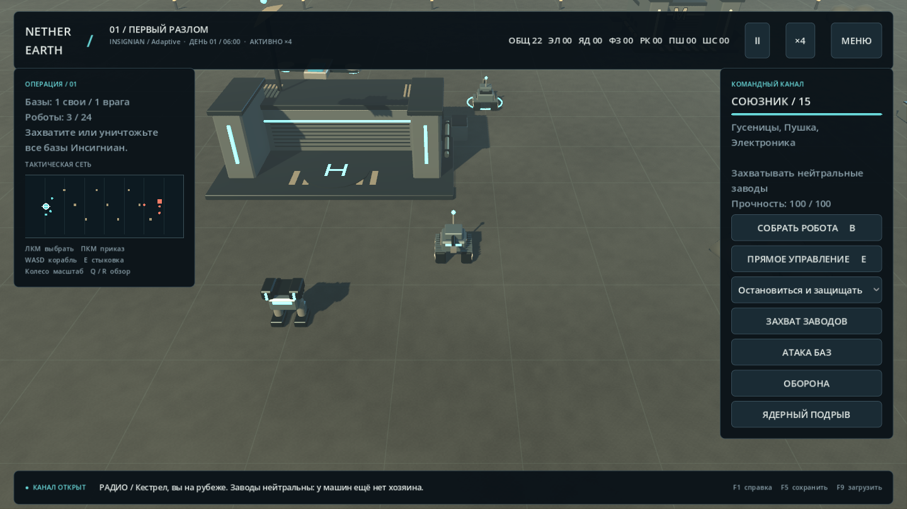

# Nether Earth — Reclamation

Независимый фанатский ремейк Nether Earth для Windows x64 на Godot 4.5.1. **Играбельная alpha 0.1:** исходный театр войны, модульные роботы, автономные приказы, экономика, три новые главы и два подхода к AI.

**Это ещё не доказанная полная копия ZX Spectrum.** Числовые правила и структура классического AI восстановлены по аннотированному дизассемблеру. Коллизии, часть локального поведения и генератор случайных чисел отличаются; тактовой сверки с оригинальным исполняемым кодом пока нет. Подробная граница соответствия — в [docs/FIDELITY.md](docs/FIDELITY.md).



Кадр из приложения. Проект использует процедурную 3D-графику; права на оригинальную игру и сторонние материалы не передаются лицензией этого репозитория. См. [атрибуцию](THIRD_PARTY.md).

## Запуск

В распакованной сборке откройте **`NetherEarth.exe`**; после локальной сборки он находится в `build/`. Исходный репозиторий не содержит готового EXE. Установка Godot, Python и подключение к сети игроку не нужны. Все игровые ресурсы встроены в EXE.

- По умолчанию используется Vulkan / Forward+: PBR-материалы, динамические тени, SSAO, свечение и объёмный туман.
- Для видеокарт без подходящей поддержки Vulkan запустите `Compatibility.cmd`: OpenGL 3.3, без части эффектов.
- `F11` переключает полный экран.
- Проверено на Windows с AMD Radeon RX 6750 XT. Другие видеокарты и ОС не проверены.

Начните с **«Начать кампанию»**. В первой главе уже есть два робота; выберите один и отдайте приказ захватывать заводы. На оригинальной карте начальных роботов нет: выберите базу и нажмите `B`.

## Что реализовано

- Исходная карта 512 × 16: 4 базы, 24 завода и 434 элемента местности, извлечённых из таблиц дизассемблера. 3D-здания и их коллизии реконструированы отдельно.
- Три дополнительные главы: «Первый разлом», «Слепое небо», «Сердце под землёй»; вступления, радио-события, итоговые рапорты и сохранение прогресса. Финальный рапорт зависит от применения ядерного оружия против баз.
- Бипод, гусеницы, антиграв; пушка, ракеты, фазер, ядерный заряд и электроника. До трёх видов оружия на роботе.
- Семь типов ресурсов, специализированные заводы, суточный доход, предел ресурсов 99, лимит 24 робота на сторону.
- Девять исходных приказов плюс команда перемещения в точку; прямое управление, огонь, захват заводов и баз, поражение и победа.
- Классический стратегический AI по структуре Z80-кода, тактический AI с защитой баз и захватом промышленности, осадный профиль с ядерными носителями.
- Сборка с вращающимся 3D-предпросмотром, миникарта, масштабирование и поворот камеры, пауза, ускорение, сохранение/загрузка и синтезированные эффекты звука.
- Новые карты и сюжетные события задаются JSON; стратегический AI отделён от ядра и рендера.

Графика использует собственные процедурные модели и материалы. Это стилизованная 3D-сцена, без фотореалистичных ассетов или перенесённых спрайтов оригинала.

## Управление

| Клавиша | Действие |
|---|---|
| ЛКМ / ПКМ | Выбрать / двигаться, атаковать робота или захватить здание |
| WASD, Shift | Корабль и камера; ускорение перемещения |
| E | Прямое управление выбранным роботом / выход |
| Пробел | Огонь при прямом управлении |
| B | Сборка на выбранной или ближайшей своей базе |
| Tab / Home | Следующий робот / своя база |
| Колесо, Q / R | Масштаб / поворот камеры |
| P, 1 / 2 / 3 | Пауза, скорость ×1 / ×2 / ×4 |
| F5 / F9 | Сохранить / загрузить |
| F1 / Esc / F11 | Справка / меню / полный экран |

Приказ захвата заставляет робота занять вход и удерживать его. На исходной карте нужно 144 такта, то есть 28,8 секунды на скорости ×1. В кампании — 100 тактов. Здания разрушаются ядерным зарядом; он также уничтожает носитель и соседние машины обеих сторон.

В этой версии корабль и мышь дают удобное дистанционное командование: физическая посадка корабля не является обязательным условием управления.

## Сохранения и свои карты

Папка данных на Windows: `%APPDATA%\Godot\app_userdata\Nether Earth — Reclamation\`.

- `save.json` — текущее сохранение; `save.backup.json` — предыдущая копия.
- `campaign.json` — результаты глав.
- `maps/*.json` — пользовательские карты. Папка открывается кнопкой в списке миссий.

Начните со своей копии `data/maps/breach.json`, задайте уникальный `id`, поменяйте здания, местность и сюжет. Валидация отбрасывает неподходящие файлы. Подробности — [docs/EXTENDING.md](docs/EXTENDING.md).

## Разработка и сборка

Для чистого клона нужны Windows x64, PowerShell и Python 3.12, доступный командой `python`. Скачайте исходники или клонируйте репозиторий, откройте PowerShell в его корне и выполните:

```powershell
./tools/setup.ps1
./tools/build.ps1
```

`setup.ps1` скачивает официальный редактор и Windows-шаблон. Для получения шаблона используется Python 3.12; скрипт читает только Windows-часть официального ZIP через HTTP Range и проверяет CRC32. `build.ps1` сначала импортирует ресурсы, затем запускает headless-тесты симуляции, экспортирует самостоятельный EXE и создаёт `build/NetherEarth-Windows-x64.zip` с документацией и лицензиями. Во время установки инструментов нужен доступ к GitHub; запуск игры после сборки работает без сети. Для разработки можно открыть `project.godot` в скачанном Godot 4.5.1.

```powershell
./.tools/godot/Godot_v4.5.1-stable_win64_console.exe --headless --path . --script tests/test_simulation.gd
./.tools/godot/Godot_v4.5.1-stable_win64_console.exe --path . --script tests/test_ui.gd
```

**UI-тест — отдельная ручная проверка, он не запускается в CI.** `tests/test_ui.gd` запускает приложение, проверяет меню, сборку, управление и сохранения; создаёт кадры в `build/`. Пользовательские сохранения восстанавливаются после успешного завершения теста.

Структура: `src/rules.gd` — числовые правила; `src/simulation.gd` — детерминированная симуляция; `src/ai/commander.gd` — стратегии; `src/world_view.gd` — 3D; `src/main.gd` — интерфейс и кампания; `data/` — карты и профили.

Материалы исследования: [аннотированный дизассемблер Santiago Ontañón](https://github.com/santiontanon/netherearth-disassembly). Зафиксирован commit `762e33e4bb1a5d2f608c6436d489a8376ef11cd5`. Лицензии и атрибуция — [THIRD_PARTY.md](THIRD_PARTY.md).


## Автоматические проверки

[Windows CI](.github/workflows/ci.yml) устанавливает Python 3.12 и Godot 4.5.1, проверяет синтаксис Python-инструментов, запускает headless-тесты симуляции и собирает Windows ZIP. Результаты конкретного запуска и архив доступны во вкладке Actions. CI не проверяет графику, полное прохождение кампании или соответствие оригиналу; границы проверок описаны в [docs/TESTING.md](docs/TESTING.md).

## Лицензия

[MIT](LICENSE) применяется к новой реализации и созданным для неё материалам. Атрибуция оригинальной игры, исследовательских материалов и Godot сохранена в [THIRD_PARTY.md](THIRD_PARTY.md).
